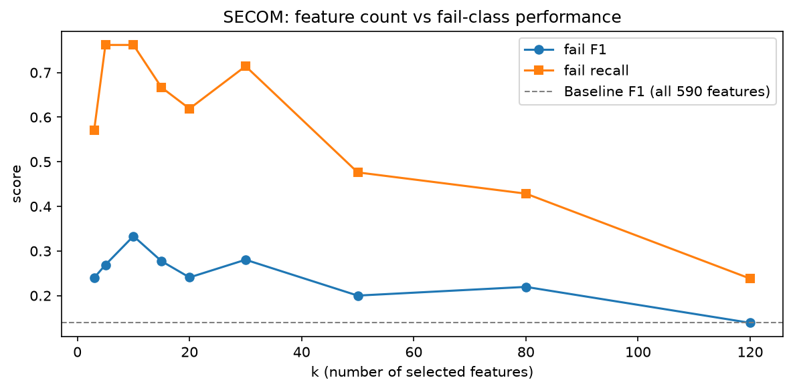
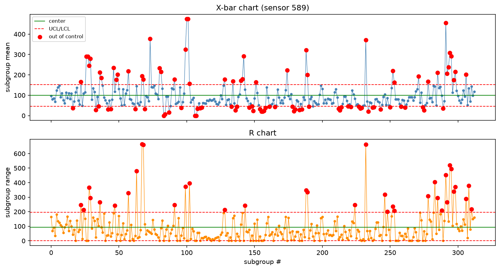
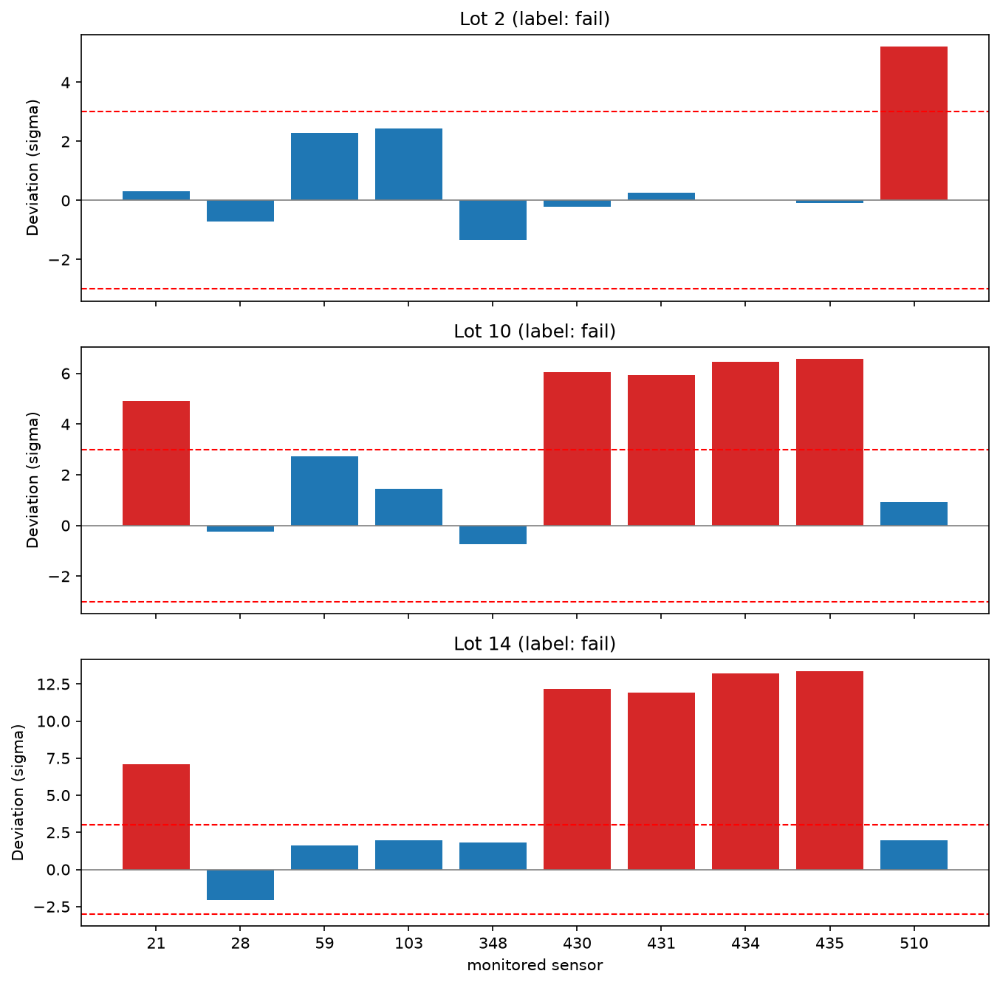
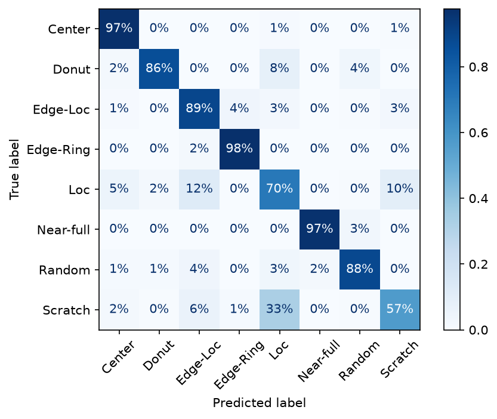
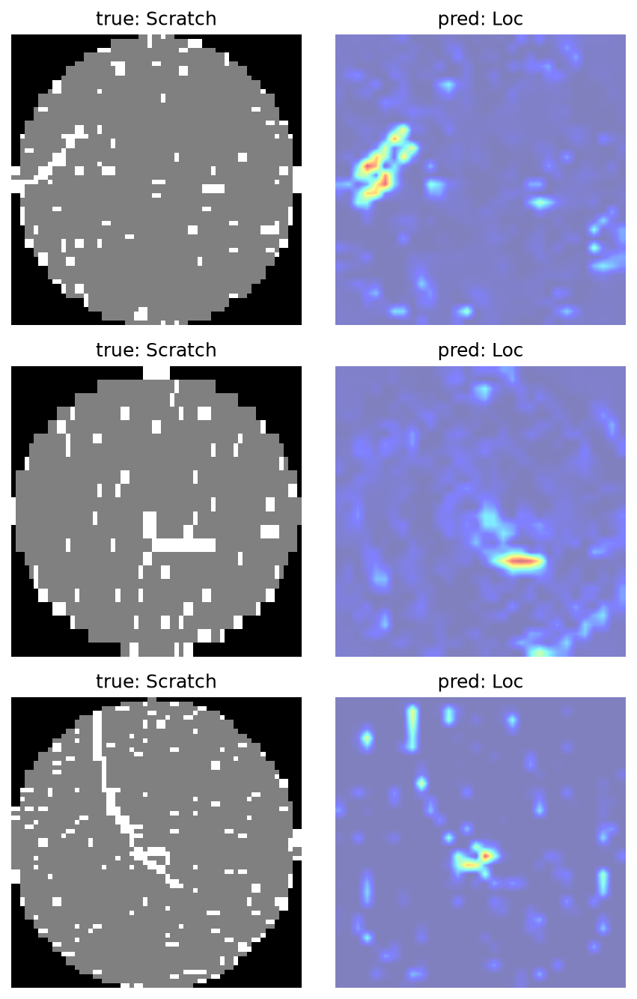
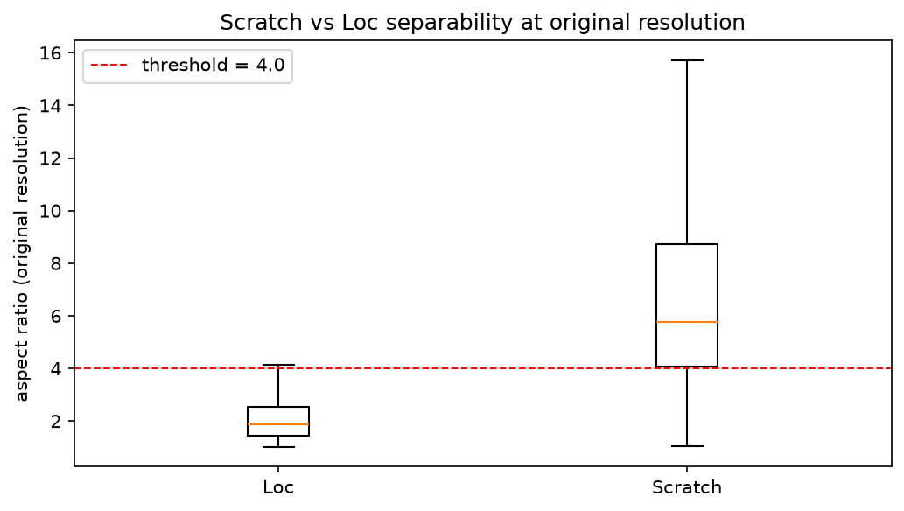

# wafer-defect-spc
> SECOM 데이터셋과 WM-811K 데이터셋을 활용해 불량 유효인자를 선별하고 불량 패턴을 분석하는 프로젝트

---
#### 0. 요약

- SECOM: ANOVA F-검정으로 인자 10개를 선별해 불량 검출 재현율을 0.19에서 0.76으로 개선
- SECOM: 정상 Lot 기준선 대비 z-score로 이상 Lot의 원인 인자 후보를 순위화하는 진단 도구 구현
- WM-811K: CNN으로 macro F1 0.842를 기록했으나 Scratch의 약 33%가 Loc으로 오분류
- WM-811K: 개선 실험 3종이 모두 실패한 뒤, 원본 해상도에서 결함의 종횡비를 재측정해 두 패턴이 형태로 갈리는 것을 확인 (Scratch 5.78 vs Loc 1.86)

---

#### 1. SECOM - 불량 유효인자 선별로 재현율 개선




| 모델               | 인자 수 | fail F1 | fail recall | 비고                         |
| ---------------- | ---- | ------- | ----------- | -------------------------- |
| baseline         | 590  | 0.14    | 0.19        | 샘플에 비해 인자가 너무 많아 과적합       |
| SelectKBest k=30 | 30   | 0.28    | 0.71        | ANOVA F-검정                 |
| SelectKBest k=10 | 10   | 0.33    | 0.76        | 불량 16/21 검출 (k-sweep best) |


- 허나 False Negative가 False Positive보다 치명적이긴 하더라도 정밀도가 낮긴 함

---

#### 2. SECOM - X-bar / R 구현 및 이탈점 검출



- Subgroup은 연속 5개 샘플로 잡았으나, SECOM 데이터셋이 단일 공정의 균일 시계열이 아니라 한계가 있음

---


#### 3. SECOM - 공정 이상의 원인 인자 진단



- 정상 Lot으로 인자마다 평균과 표준편차를 정의
- 이를 기반으로 z-score를 규정 (X-avg/sigma)
- x축이 인자, y축이 z-score, 양품이 아닌 Lot 2, 10, 14에 대해 그래프 작성
- x축에 수평한 빨간 직선은 avg로부터 3sigma만큼 떨어진 지점
- 430, 431, 434, 435 인자의 경우 Lot 10과 14에서 동반이탈이 발생
- Lot 14의 경우 430, 431, 434, 435 인자의 계측값이 모두 400.000이므로, 센서의 측정 상한에 걸렸을 가능성도 배제할 수 없음
- Lot 2의 경우 Lot 10, 14와 다른 양상을 보임
- SECOM 데이터셋이 익명화되어있지 않았다면 원인 인자와 연결된 실제 장비까지 추적할 수 있었을 것임
- 21, 28, 59, 103, 348, 430, 431, 434, 435, 510 인자는 ANOVA-F 검정, k=10으로 선별된 인자임
- 3sigma 조건 단독으로 양품이 아닌 Lot을 탐지하는 경우, 재현율 19.2%, 위양성률 5.5%를 보임

---


#### 4. WM-811K - 웨이퍼 불량 8종 CNN 분류


| 지표        | 값                      |
| --------- | ---------------------- |
| macro F1  | 0.842                  |
| Near-full | recall 0.97            |
| Scratch   | recall 0.57 · F1 0.568 |


- 크기가 다양한 WM-811K 데이터셋을 일률적으로 64×64로 리사이즈
- CNN 모델로 8종 분류
- Edge-Ring 클래스가 9,680장인 반면 Near-full 클래스는 149장 밖에 되지 않는 불균형을 보정하기 위해 balanced 키워드 사용 
- 불균형이 존재하는 데이터셋이라 accuracy만 보면 다수 클래스 착시가 발생하니 macro F1을 주지표로 두고 per-class로 평가
- Near-full 클래스의 recall 값은 괜찮게 나왔으나, Scratch 클래스의 recall 값과 F1이 저조

---


#### 5. WM-811K - Scratch 오분류의 물리적 해석



- Scratch의 약 33%가 Loc로 오분류. Scratch와 Loc이 공간적으로 유사한 패턴이라는 점이 원인이라고 추정

---


#### 6. WM-811K - 모델의 판단 근거 시각화



- Grad-CAM 활용
- Scratch -> Loc 오분류 사례에 대해 실제 스크래치 궤적을 보고 있으나 이를 Loc으로 오인 것으로 보임

---


#### 7. WM-811K - 오분류 개선 실험 3종 실패


| 실험           | 가설                            | 결과                                                  |
| ------------ | ----------------------------- | --------------------------------------------------- |
| 회전/반전 증강     | 방향 불변성 학습으로 Scratch 다양성 확보    | Scratch→Loc은 줄었으나 Loc→Scratch가 폭증, 전 클래스 F1 하락(순손실) |
| 해상도↑ (64→96) | 가는 선 형태를 더 보존                 | macro 0.842→0.807, Scratch F1 0.568→0.457 (64 완승)   |
| 고전 도메인 피처    | 스크래치는 물리적으로 '선' → 직선성·종횡비로 분리 | Scratch/Loc 분포가 겹쳐 분리 실패 (중앙값 1.17 vs 1.17)         |


- Grad-CAM 진단을 바탕으로 세 가지 처방을 동일 조건 A/B로 검증했으나, 모두 baseline을 넘지 못했다.

---


#### 8. WM-811K - 원본 해상도 사용 및 결함 픽셀 연결요소 분리로 Scratch와 Loc 분리 성공



- 앞선 세 개선 실험은 모두 축소된 이미지 해상도 상에서의 접근이었음
- 리사이즈하지 않은 원본 웨이퍼맵을 활용하고, 결함 픽셀을 연결요소들로 분리한 뒤 가장 긴 성분의 종횡비를 측정하는 방식 채택
- Scratch 클래스와 Loc 클래스에서 각각 5.78, 1.86이 나오며 종횡비가 완전히 분리
- 또한, Loc 클래스의 75% 지점이 Scratch 클래스의 25% 지점보다 낮은 종횡비를 가짐을 확인
- 또한, 두 클래스를 구분짓는 단일 임계값(4.0)만으로도 Scratch 클래스의 F1이 0.777로 기록되어, 4에서 기록한 0.568보다 개선됨
- 물론 이는 두 클래스만 놓고 F1을 계산한 것이므로 직접 비교는 아니라는 한계가 있음
- 결론적으로 64x64 해상도에서 발생한 형태적 모호성이 원본 해상도에서는 사라졌음을 알 수 있다.
- 또한, 해상도와 측정 방법(연결요소 분리)을 동시에 바꿨으므로, 둘 중 무엇이 분리를 만들었는지는 아직 가르지 못함

---


### 참고사항


#### 데이터셋 설명


##### 1. SECOM 데이터셋

공정 중 센서 데이터셋으로써, 불량 유효인자 선별에 활용된다. 1,567개 샘플에 대해 각각 590개 센서의 측정값과 해당 샘플의 양품 여부가 기록되어있다. 센서는 익명화 되어있어, 해당 센서가 어떤 장비로부터 나온 값인지는 알 수 없다.

##### 2. WM-811K 데이터셋

공정 후 웨이퍼맵 데이터셋으로써, 불량 패턴 분석에 활용한다. 전체 811,457장의 2차원 웨이퍼맵 데이터 중, 불량 패턴 종류 라벨이 존재하는 데이터는 25,519장이다.

#### 코드 실행 방식

```bash
# conda (주 환경 — Python 버전까지 재현)
conda env create -f environment.yml
conda activate wafer_env

# 또는 pip
pip install -r requirements.txt

# 단위 테스트 (SPC 로직 검증)
pytest -q
```


#### 폴더 구조

```
wafer-defect-spc/
├── README.md            # 프로젝트 개요 · 결과 · 실행법
├── environment.yml      # conda 환경 (재현용, 주 환경)
├── requirements.txt     # pip 패키지 (폴백)
├── .gitignore
├── data/                # 데이터셋 (원본은 git에 올리지 않음)
│   └── README.md        # 다운로드 방법
├── notebooks/           # 탐색·실험 (# %% 셀 단위 실행 가능)
│   ├── 01_eda.py        # WM-811K EDA (분포·웨이퍼맵·불균형)
│   ├── 02_spc.py        # SECOM에 관리도 적용·시각화
│   ├── 03_secom_baseline.py  # baseline 분류 + 유효인자 선별 (예측)
│   ├── 04_wafer_cnn.py  # WM-811K CNN 불량분류 + Grad-CAM + 개선 실험
│   └── 05_secom_fdc.py  # 공정 이상의 원인 인자 자동 진단 (진단)
├── src/                 # 재사용 로직
│   └── spc.py           # 관리도·Cpk·이탈점 검출 (핵심 로직 직접 구현)
├── tests/               # 단위 테스트
│   ├── conftest.py      # src/ import 경로 설정
│   └── test_spc.py      # spc.py 검증 (손계산 근거 주석 포함)
└── docs/
    ├── devlog.md        # 개발일지 — "왜 이렇게 했는지" 기록 (신뢰도의 증거)
    └── figures/         # README·devlog용 차트 PNG
```


#### Git 규칙

- 데이터 원본(WM-811K, SECOM)은 용량이 커 git에 포함하지 않는다. 다운로드 방법은 `data/README.md` 참고.


#### 프로젝트와 DMAIC 매핑


| DMAIC   | 실제로 한 일                                                           | 대응하는 직무 역량     | 상태       |
| ------- | ----------------------------------------------------------------- | -------------- | -------- |
| Define  | 대상 선정(SECOM 공정중 센서 / WM-811K 공정후 불량맵), 성공 기준을 recall 우선으로 정의      | 불량 분석 방향 설정    | 부분적으로 구현 |
| Define  | CTQ 명문화 · SIPOC · 목표수준 근거                                         | 과제 정의          | 미 구현     |
| Measure | 데이터 적재·구조 파악(`01_eda.py`), 결측(median)·불균형(class_weight) 처리        | 데이터 분석 역량      | ✅        |
| Measure | 관리도(X-bar/R)·공정능력 Cp/Cpk 직접 구현 + 단위 테스트(`src/spc.py`, `tests/`)   | 통계적 공정관리(SPC)  | ✅        |
| Measure | MSA — 분류기의 반복성·재현성, Kappa 일치도                                     | 계측 신뢰성         | 미 구현     |
| Analyze | ANOVA F-검정으로 590개 → 유효 인자 10개 선별(k-sweep)                         | 유효 인자 감지       | ✅        |
| Analyze | 정상 Lot 기준선 대비 z-score로 원인 인자 순위화(`05_secom_fdc.py`)               | 불량 원인 추적       | ✅        |
| Analyze | Grad-CAM으로 오분류 판단 근거 시각화                                          | 불량 분석          | ✅        |
| Analyze | 특성요인도(5M1E) + FMEA로 원인 구조화                                        | 근본원인 도출        | 미 구현     |
| Improve | CNN 8종 분류(macro F1 0.842) + baseline 로지스틱 회귀 개선(recall 0.19→0.76) | AI 기법 활용 불량 예측 | ✅        |
| Improve | 개선 실험 A/B 3종 → 실패 → 원본 해상도 형태 피처로 결론 반전                           | 조건 최적화         | ✅        |
| Improve | DOE 2³ 요인배치로 실험 재설계(교호작용 확인)                                      | 실험 설계          | 미 구현     |
| Control | 관리계획서 + 모델 성능 관리도(배치별 macro F1 관리한계선)                             | 수율 개선 / 품질 관리  | 미 구현     |
| Control | 회고·의사결정 기록(`docs/devlog.md`)                                      | —              | ✅        |


- 단계별 충족도와 채울 계획은 `[docs/dmaic.md](docs/dmaic.md)`.
- 이와 별개로 이상탐지(Isolation Forest, Autoencoder)와 결과를 한 눈에 시각화하는 대시보드를 제작할 계획이 있음


#### WM-811K 데이터셋의 불량 패턴과 대표적인 불량 원인공정 매핑


| 패턴        | 대표 공정 원인                       | 관련 전공정                 |
| --------- | ------------------------------ | ---------------------- |
| Center    | 증착/CMP 중심부 불균일, 스핀코팅           | ThinFilm · CMP · Photo |
| Donut     | 반경방향(radial) 불균일               | CMP · ThinFilm         |
| Edge-Ring | 가장자리 식각/증착 불균일, edge exclusion | Etch · ThinFilm        |
| Edge-Loc  | 가장자리 국소 이상(척 접촉·핸들링)           | Etch · 장비 Set-up       |
| Loc       | 국소 오염·파티클                      | Cleaning · 파티클 관리      |
| Near-full | 대형 공정 이탈(레시피·장비 이상)            | 공정 안정화 · 장비 Set-up     |
| Random    | 무작위 파티클 오염(환경·자재)              | Cleaning · 환경          |
| Scratch   | 기계적 핸들링 손상, CMP 스크래치           | CMP · 핸들링(장비 Set-up)   |


- 물론 이는 추정값일 뿐이며, 실제 근본 원인은 FA로 확정해야 한다


#### 작업 원칙

- 매일 그 날의 작업 내용을 조금이더라도 커밋하기
- 본 파일에는 주요 결론만 기재하고 세부 의사결정 논리 등은 `devlog.md`에 기재

